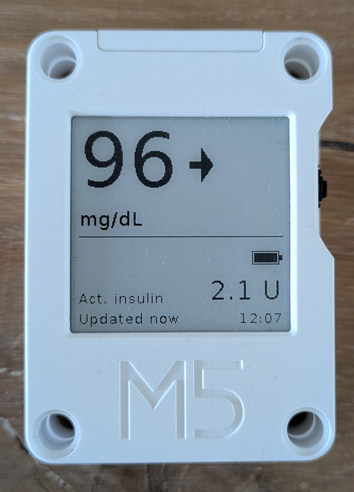
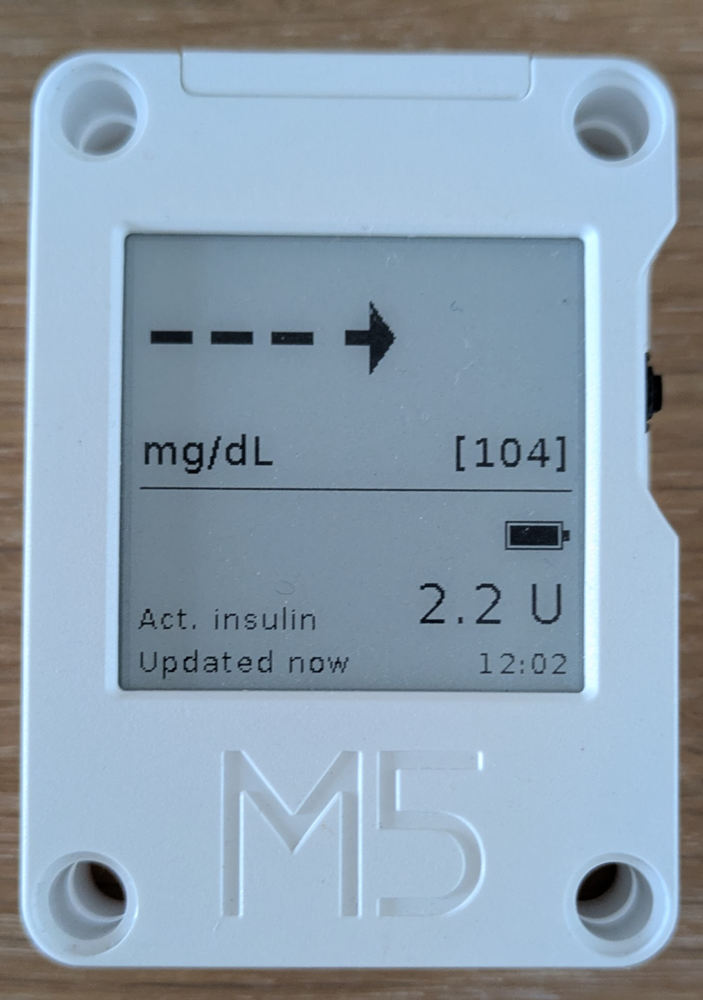
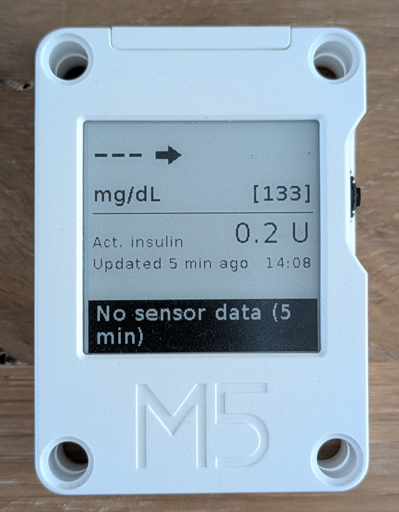
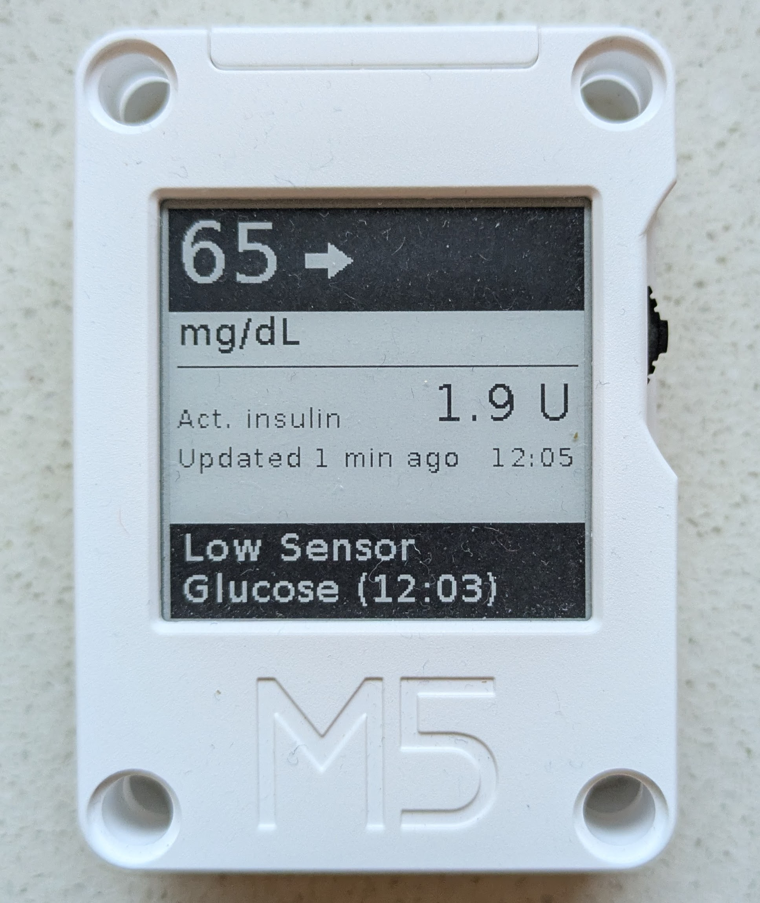

# CareLink home display

A small battery powered e-paper display that shows what a Medtronic MiniMed 770G/780G insulin
pump is doing, for the people who care for the person wearing it. It hangs in
the house, wakes every five minutes, shows the current glucose reading, trend,
active insulin and any pump alarm (with a beep), and goes back to sleep.



| No sensor data | No sensor data, 5 minutes on | Pump alarm |
|:---:|:---:|:---:|
|  |  |  |
| dashes; the last good reading in brackets | the same, with a banner once it lasts | below 70 or above 180 the reading turns white on black; the pump's alarm and its time in a banner, with a beep |

It is two parts that are built, installed and taken on a trip together:

| Part | Runs on | Directory | Licence |
|---|---|---|---|
| **Display** | M5Stack Core Ink (ESP32, 1.54" e-paper, buzzer) | [`firmware/`](firmware/) | GPL-3.0 |
| **Proxy** | Raspberry Pi | [`proxy/`](proxy/) | AGPL-3.0 |
| **Appliance** — turns a stock Pi into the proxy, with browser-based token renewal and the travel hotspots | Raspberry Pi | [`appliance/`](appliance/) | AGPL-3.0 |

```
pump ──► phone ──► CareLink Cloud ◄── proxy (Pi) ◄── display (Core Ink)
                                       :8081          every 5 minutes
```

The proxy holds the one CareLink login and re-serves the data on the local
network; the display never talks to Medtronic. The two agree on three URLs:
`GET /carelink/nohistory` (the data), `GET /carelink/trend` (the last three
hours, for the trend screen, the desktop monitor and the live page) and `GET /carelink/fallback` (the Pi's
travel hotspot, see [docs/travel.md](docs/travel.md)).

## Put the firmware on a display from your browser

**[Flash the CareLink home display](https://fredvangoolen.github.io/carelink-home-display/)**: open the page
in Chrome or Edge, connect the Core Ink with a USB-C cable and press
*Install*. No Arduino, no compiler, no command line; about a minute. The
same page updates a display that is already in use, keeping its WiFi and
proxy settings (choose *do not erase*). The page always carries the
[latest release](https://github.com/fredvangoolen/carelink-home-display/releases/latest).

## Getting started

1. **The Pi**: [`appliance/README.md`](appliance/README.md) — one script,
   `appliance/provision.sh`, then a CareLink login in a browser.
2. **The display**: flash it from the browser with
   [the flasher page](https://fredvangoolen.github.io/carelink-home-display/), then give it the home WiFi
   and the proxy's address on its setup page. Building it yourself with
   `arduino-cli` is only needed to change the firmware:
   [`firmware/minimed-coreink/README.md`](firmware/minimed-coreink/README.md). Its switch, buttons and screens at a
   glance: [the controls of the display](docs/img/display-controls.svg).

## Documentation

- [docs/manual.md](docs/manual.md) — **the user guide**: what the set does
  and what a household needs, what preparing it takes, and the display's
  screens and messages. Start here if you are not technical. In Dutch:
  [docs/handleiding.md](docs/handleiding.md).
- One-page handout for an event or a first conversation, as an A4 PDF:
  [English](docs/handout/carelink-handout-en.pdf),
  [Dutch](docs/handout/carelink-handout-nl.pdf).
- [docs/runbook.md](docs/runbook.md) — staging, delivering and supporting a
  set, with the security model and its known gaps; and
  [docs/home-installation-checklist.md](docs/home-installation-checklist.md),
  the step-by-step for the visit itself.
- [docs/staging-setup.md](docs/staging-setup.md) — what you need on your own
  computer to stage a set, including flashing a released firmware from the
  browser with no build environment.
- [docs/travel.md](docs/travel.md) — taking the set somewhere else: plan A,
  plan B and the hotspots, across both halves.
- [desktop/README.md](desktop/README.md) — the display's main screen in a
  window on Windows, macOS or Linux, for a caregiver's computer and for
  debugging; and the proxy's live page at `http://<pi>:8081/display`.
- [docs/display-messages.md](docs/display-messages.md) — every message the
  display can show, which one wins, what triggers it and when it clears;
  the rules the display, the desktop app and the live page share.
- [docs/lessons.md](docs/lessons.md) — things that cost a day to find out.
- [docs/testing.md](docs/testing.md) — test builds, what is verified on
  hardware, and what is still untested.
- [docs/carelink-api.md](docs/carelink-api.md) — notes on the undocumented
  CareLink Cloud API; `docs/carelink-data.ods` describes the JSON the proxy
  serves.
- [`firmware/minimed-coreink/architecture.md`](firmware/minimed-coreink/architecture.md)
  — how the firmware is put together.

## Credits and licence

This is built on other people's work; see [LICENSE.md](LICENSE.md) for who and
for the licence of each directory.

## Disclaimer

This project is for educational and informational purposes only. It relies on
a series of fragile components and assumptions, any of which may break at any
time. It is not approved by any regulator and must not be used to make medical
decisions. It is neither affiliated with nor endorsed by Medtronic, and may
violate their Terms of Service. Use of this code is without warranty or
support of any kind.
