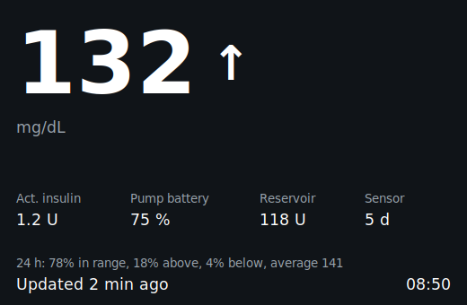

# Desktop monitor

The display's *Glucose* screen in a window on an ordinary computer: Windows,
macOS or Linux. It reads the same proxy as the Core Ink display, so it needs
the box (the Pi) on the same network.

Use it as a backup when there is no display at hand, a second screen on the
patient's own desk, or a debugging aid: it shows exactly what the proxy
serves, and how it reads it.



It is not a medical device and not an alarm system. A computer that sleeps,
or a window that is closed, shows nothing and sounds nothing.

## Install

Only Python 3.8 or newer, with Tk. Nothing to `pip install`.

| System | Install | Start |
|---|---|---|
| Windows | Python from [python.org](https://www.python.org/downloads/) (the default install includes Tk) | double-click `minimed_desktop.pyw` |
| macOS | Python from [python.org](https://www.python.org/downloads/) (not the system or Homebrew Python, whose Tk is old or missing) | `python3 minimed_desktop.py` |
| Linux | `sudo apt install python3-tk` | `python3 minimed_desktop.py` |

Copy this whole `desktop/` directory: the program needs `faults.py` next to
it. On first start it asks for the proxy's address (the name or IP address
of the box, for example `carelink-01` or `192.168.1.20`; the port defaults
to 8081). It remembers it, and the *Keep on top* setting, in:

- Windows: `%APPDATA%\carelink-monitor\config.json`
- macOS: `~/Library/Application Support/carelink-monitor/config.json`
- Linux: `~/.config/carelink-monitor/config.json`

To start it with the computer, put a shortcut to `minimed_desktop.pyw` in
the Windows *Startup* folder (`Win+R`, `shell:startup`), or add
`python3 /path/to/minimed_desktop.py` to your desktop's autostart.

Then set the computer not to sleep while plugged in. A computer that sleeps
shows a frozen screen.

## What it shows

The same as the display, by the same rules:

- the reading, red below 70 and amber above 180 mg/dL, with the trend when
  auto mode is on; `---` with the last reading in brackets when there is
  none;
- one banner, in the display's order: a pump alarm (with the time it
  occurred), then why there is no reading (*No sensor data*, *Proxy has no
  data*, *CareLink login needed*, *No link to proxy*), then *No new reading
  for …* once the reading is 20 minutes old, then the pump's own banner;
- active insulin, pump battery, reservoir, sensor time left, the 24-hour
  statistics, and how long ago the reading was taken.

**Sound.** A pump alarm or alert from the last 15 minutes plays a tone when
it first appears and again every 5 minutes while it shows, like the
display's beep each cycle. A low or high glucose alarm stops once the
reading is back in range. *Monitor → Test sound* plays it. On Linux it uses
`paplay`, `pw-play` or `aplay`, whichever exists; with none of them only the
system bell sounds (*Monitor → About* says which).

It polls the proxy every minute (*Monitor → Refresh now* to do it at once).
One failed poll changes nothing on screen; after three in a row it says *No
link to proxy*.

**Time.** The age of the reading is measured on the proxy's clock, taken
from each answer, so a computer whose clock is off still shows it right.
Alarm times are read as this computer's local time, which is right as long
as the computer is in the patient's time zone.

## For debugging

```bash
python3 minimed_desktop.py --check                 # fetch once, print what the window would show, exit
python3 minimed_desktop.py --check --proxy carelink-02  # the same, against another proxy (not remembered)
python3 minimed_desktop.py --file answer.json      # show a saved /carelink/nohistory answer
python3 minimed_desktop.py --debug                 # window, and log every poll to the terminal
```

`--check` exits 0 with a reading (or the routine *No sensor data*), 2
otherwise, so it can sit in a script. *Monitor → Show proxy answer* shows the
last raw answer next to how it was read.

To try a case without waiting for it, save an answer
(`curl http://carelink-01:8081/carelink/nohistory > answer.json`), edit
it, and open it with `--file`. Saved answers hold patient data: keep them
out of the repository (`data-*.json` is ignored for that reason).

## Fault texts

`faults.py` is generated from the firmware's
`firmware/minimed-coreink/faults.cpp`, the one source of the pump's fault
texts, together with `proxy/display/faults.js` for the proxy's web page:

```bash
python3 desktop/gen_faults.py          # after every change to faults.cpp
python3 desktop/gen_faults.py --check  # exits 1 if either is out of date
```

## Where it comes from

A rewrite of `minimed-mon-pc.py` from Ondrej Wisniewski's
[M5 Minimed Monitor](https://github.com/ondrej1024/m5-minimed-monitor)
(GPL-3.0). The rules for age, staleness, link faults and alarms are the
firmware's: the original's minute-and-hour age arithmetic, alarm window and
DST handling each gave plausible-looking wrong answers there. GPL-3.0, see
[LICENSE](LICENSE).
