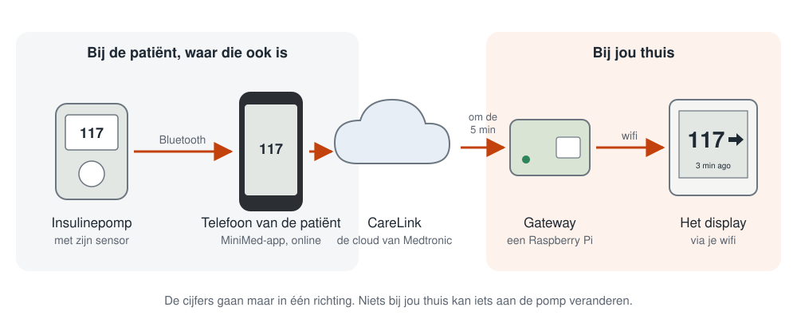
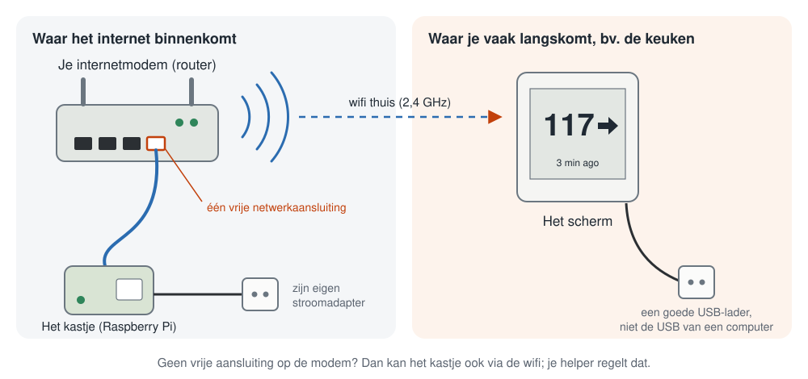
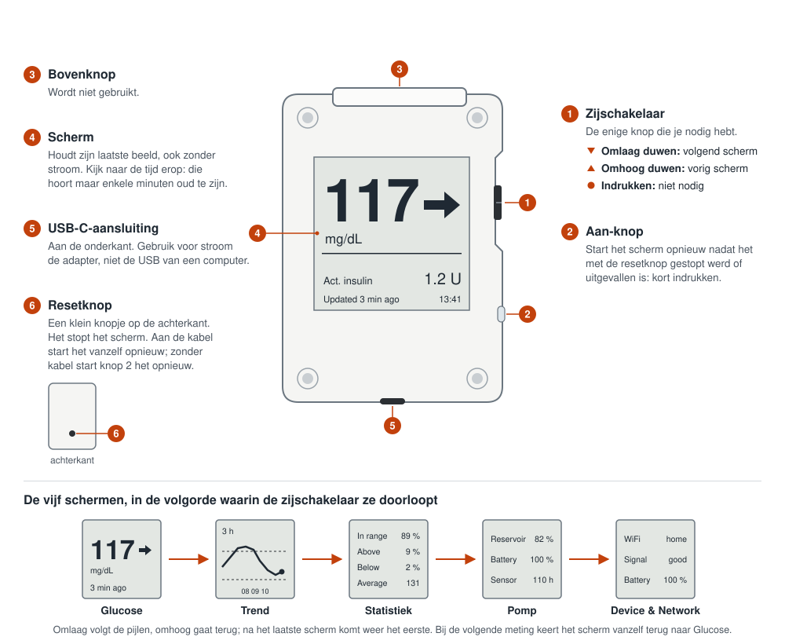

# CareLink home display — handleiding

*[English version](manual.md)*

Een klein display bij jou thuis dat de glucosewaarde toont van iemand met een
Medtronic MiniMed 770G- of 780G-insulinepomp. Zo zien de mensen die voor hem
of haar zorgen in één oogopslag hoe het gaat, zonder telefoon.

Deze handleiding heeft drie delen:

1. [Wat het is en wat je nodig hebt](#1-wat-het-is-en-wat-je-nodig-hebt),
   voor iedereen.
2. [De toestellen klaarmaken](#2-de-toestellen-klaarmaken), voor de persoon
   met technische kennis die het voor je installeert.
3. [De set bij jou thuis](#3-de-set-bij-jou-thuis): waar alles komt, wat de
   schermen tonen, en wat je doet als er iets niet lijkt te kloppen.

## 1. Wat het is en wat je nodig hebt

### Hoe het werkt

De pomp stuurt zijn metingen al naar de telefoon van de patiënt, en de
telefoon stuurt ze naar CareLink, de onlinedienst van Medtronic. De set voegt
daar twee dingen aan toe, bij **jou** thuis:

- **De gateway**, een kleine computer (een Raspberry Pi) naast je
  internetmodem. Om de vijf minuten haalt hij de laatste meting op bij
  CareLink.
- **Het display**, een klein e-paperscherm van ongeveer 3 bij 3 cm. Om de vijf
  minuten wordt het wakker, haalt het de meting via je wifi bij de gateway,
  toont ze, en piept het als de pomp een alarm geeft.

De patiënt hoeft niet thuis te zijn: het display werkt waar die ook is, zolang
de telefoon aanstaat, dicht bij de pomp is en internet heeft.

### Wat het niet is

- **Het kan niets veranderen.** Het toont alleen cijfers. Niets in de set kan
  insuline geven, pompinstellingen wijzigen of een pompalarm uitzetten.
- **Het is geen medisch hulpmiddel en geen alarmsysteem.** De pomp en de
  telefoon blijven degene die waarschuwen. Het display toont dezelfde cijfers
  in een andere kamer.
- **Het loopt altijd een paar minuten achter.** De pomp, de gateway en het
  display werken elk in stappen van vijf minuten.
- **Het hangt af van de telefoon van de patiënt.** Staat die uit, is hij te
  ver van de pomp of zonder internet, dan meldt het display dat; dat is geen
  fout van de set.

### Wat je nodig hebt

| Wat | |
|---|---|
| **De twee toestellen** | de gateway en het display, klaargemaakt door je helper (deel 2) |
| **Internet thuis** | een modem met **één vrije netwerkaansluiting** voor de gateway. Geen vrije aansluiting: dan kan de gateway via je wifi |
| **De naam en het wachtwoord van je wifi** | het display maakt verbinding met je wifi. Het heeft wifi op 2,4 GHz nodig; bijna elke modem biedt dat, vaak onder dezelfde naam |
| **Een apart CareLink-account voor het display** | zie hieronder |
| **Twee stopcontacten** | één bij de modem voor de gateway, één waar het display komt |
| **Een helper met technische kennis** | om de toestellen klaar te maken en samen met jou te installeren, ongeveer 45 minuten bij je thuis |

### Een apart CareLink-account, aanvaard door de patiënt

De gateway meldt zich bij CareLink aan met een eigen account: een
**zorgpartner-account**. Dat is een gewoon CareLink-account, alleen voor dit
display aangemaakt, dat de **patiënt als zorgpartner uitnodigt** vanuit zijn
of haar eigen CareLink-account, en dat de uitnodiging aanvaardt. Pas dan mag
de gateway de gegevens van de patiënt lezen.

Waarom een apart account:

- **De patiënt houdt de controle.** De zorgpartner verwijderen in het eigen
  account zet het display uit, zonder het eigen wachtwoord te wijzigen.
- **Het is veiliger.** De gateway bewaart alleen de aanmelding van dit
  account, en dat kan de gegevens van één patiënt lezen, niets meer.
- **Het mag nergens anders gebruikt worden.** Met een zorgpartner-account
  kan je maar op één plaats tegelijk aangemeld zijn. Wie zich ermee aanmeldt
  op een telefoon of in een tweede gateway, legt het display een paar uur later
  stil.

Wie dat account beheert, houdt het **wachtwoord en het toestel dat de
tweestapscode ontvangt** (de extra code die CareLink bij het aanmelden vraagt)
bij de hand. Die zijn één keer nodig bij de installatie, en daarna ongeveer
twee keer per jaar, wanneer CareLink een nieuwe aanmelding vraagt (zie
[deel 3](#ongeveer-twee-keer-per-jaar-opnieuw-aanmelden)).

### Wie doet wat

| Wie | Wat |
|---|---|
| **De patiënt** | nodigt het zorgpartner-account uit vanuit het eigen CareLink-account |
| **Jij, het gezin** | zorgt voor de naam en het wachtwoord van de wifi, een plek voor beide toestellen, en de aanmelding met het zorgpartner-account bij de installatie en ongeveer twee keer per jaar |
| **Je helper** | maakt beide toestellen klaar, installeert ze samen met jou, en is degene die je belt als er iets mis is |

## 2. De toestellen klaarmaken

*Voor de helper.* Dit deel zegt wat erbij komt kijken en welke kennis het
vraagt. De stap-voor-stapinstructies staan (in het Engels) in het
[staging and support runbook](runbook.md), de [home installation
checklist](home-installation-checklist.md) en [what you need on your own
computer](staging-setup.md).

### Welke kennis het vraagt

Je hoeft geen programmeur te zijn. Je moet wel vlot omgaan met:

- **Instructies tot op de letter volgen**, ook commando's in een terminal
  precies zo intypen als ze er staan, en lezen wat er terugkomt.
- **Een Raspberry Pi klaarmaken**: een geheugenkaart beschrijven met
  Raspberry Pi Imager, en vanaf je laptop op de Pi inloggen via SSH, met een
  sleutel in plaats van een wachtwoord.
- **Thuisnetwerken**: een vrije aansluiting op een modem vinden, wifi op
  2,4 GHz van 5 GHz onderscheiden, en een telefoon of laptop met een bepaalde
  wifi verbinden.
- **Wachtwoorden en accounts**: per gezin een paar wachtwoorden veilig
  bewaren, en iemand door een aanmelding met tweestapscode helpen zonder ooit
  het wachtwoord te zien.
- **Het aanspreekpunt zijn**: het gezin belt jou als het display er vreemd
  uitziet. Het meeste kan je op afstand nakijken, via Raspberry Pi Connect.

### Boodschappenlijst

| Wat | Opmerking |
|---|---|
| M5Stack Core Ink | het display |
| Raspberry Pi 4 | de gateway; het model waarop dit getest is |
| microSD-kaart, 16 GB of meer | voor de Pi |
| Raspberry Pi-stroomadapter | de officiële: een zwakke adapter geeft fouten die op softwareproblemen lijken |
| Netwerkkabel | van de modem naar de Pi |
| USB-C-lader voor het display | een goede, niet de USB-poort van een computer |

### Het display: in de browser flashen

De software van het display staat er in ongeveer een minuut op, vanaf een
webpagina:
**[Flash the CareLink home display](https://fredvangoolen.github.io/carelink-home-display/)**.
Open ze in Chrome of Edge op een laptop, sluit de Core Ink aan met een
USB-C-kabel en druk op *Install*. Kies *Erase* voor een nieuw display of een
display dat naar een ander gezin gaat; kies niet wissen om een display in
gebruik bij te werken.

De wifi van het display en het adres van de gateway vul je later in, bij het
gezin thuis: een gewist display toont een QR-code die een telefoon naar de
instelpagina leidt.

### De gateway: op je eigen bureau klaarmaken

Op je eigen bureau, vóór het bezoek, de eerste keer ongeveer een uur:

1. Zet Raspberry Pi OS Lite op de geheugenkaart met Raspberry Pi Imager, met
   een naam voor de gateway (`carelink-<naam>`) en je SSH-sleutel.
2. Log er vanaf je laptop op in en start één script, dat alles installeert:
   `appliance/provision.sh`.
3. Kies het wachtwoord voor het aanmeldscherm (het VNC-wachtwoord), druk het
   label voor de instel-hotspot af, en koppel de gateway aan Raspberry Pi
   Connect voor hulp op afstand.

De gateway meldt zich **niet** op je bureau aan bij CareLink. Dat gebeurt bij
het gezin thuis, met het zorgpartner-account, zodra de gateway op het
thuisnetwerk zit.

### Het bezoek

Ongeveer 45 minuten, volgens de [home installation
checklist](home-installation-checklist.md): de gateway aansluiten, de
accountbeheerder op een laptop laten aanmelden bij CareLink, het display
instellen met een telefoon, er een goede plek voor zoeken, en nagaan dat er
een actuele meting binnenkomt.

## 3. De set bij jou thuis

- **De gateway** staat naast je internetmodem, met een netwerkkabel in een
  vrije aansluiting van de modem, en met zijn eigen stroomadapter. Hij heeft
  geen scherm en vraagt niets van jou.
- **Het display** komt op een plek waar vaak iemand langskomt, zoals de keuken
  of de gang, op zijn eigen USB-lader. Het moet de wifi goed kunnen ontvangen:
  het scherm *Device & Network* zegt hoe goed (*Signal*: *good* of *fair* is
  in orde).

### De schermen

De **zijschakelaar** is de enige knop die je nodig hebt: duw hem omlaag voor
het volgende scherm, omhoog voor het vorige. Op het scherm *Trend* druk je
hem kort in om 12 uur te zien in plaats van 3; nog eens drukken gaat terug. Het display zelf toont Engelse
woorden; hieronder staat wat ze betekenen.

| Scherm | Toont |
|---|---|
| **Glucose** | de laatste meting, de trendpijl, de actieve insuline (*Act. insulin*), en hoe lang geleden de meting is (*Updated … ago*). Alarmen van de pomp verschijnen hier, met een piep |
| **Trend** | de laatste 3 uur als lijn (*Last 3 hours*; schakelaar indrukken voor 12 uur, *Last 12 hours*, met elk derde uur onderaan), met streepjeslijnen bij 70 en 180, een fijne stippellijn bij 100 (het streefdoel van de pomp), en de uren onderaan. Op het scherm zijn de zones onder 70 en boven 180 gestippeld; de lege band ertussen is binnen bereik. De schaal past zich aan de metingen aan; gaat een piek boven 200, dan staat rechtsboven tot hoe hoog. De stip is de laatste meting; stopt de lijn voor de rechterrand, dan kwamen er sindsdien geen metingen binnen |
| **Statistiek** | de laatste 24 uur: tijd binnen bereik (*In range*), erboven (*Above*), eronder (*Below*), en het gemiddelde (*Average*) |
| **Pomp** | het reservoir, de batterij van de pomp, en hoe lang de sensor al zit |
| **Device & Network** | de wifi die het display gebruikt en hoe goed het signaal is, en de batterij van het display zelf. Je helper kan je vragen dit scherm voor te lezen. Druk hier kort op de schakelaar voor een *Debug*-scherm voor je helper (de wifi-netwerken waarvoor het is ingesteld, het MAC-adres, tellers), nog eens voor *Last polls* (tijd, wifi en resultaat van de laatste 8), een derde keer om terug te gaan; de schakelaar bewegen gaat ook terug |

Bij de volgende meting, binnen vijf minuten, keert het display vanzelf terug
naar *Glucose*.

### Hoe het er normaal uitziet

**De tijd op het scherm is een paar minuten oud.** Dat is normaal, altijd.

Het is een e-paperscherm: het houdt zijn laatste beeld, ook zonder stroom.
Een display dat gestopt is, ziet er dus precies hetzelfde uit als een display
dat werkt. **Kijk naar de tijd.** Is die meer dan ongeveer 15 minuten oud,
dan moet er iets gebeuren.

Komt er geen nieuwe meting, dan zegt een regel onderaan het scherm *Glucose*
waarom. Die regel verschijnt pas na ongeveer 15 minuten, zodat een korte
onderbreking nooit te zien is.

| Er staat | Betekent | Wat doe je |
|---|---|---|
| *No sensor data since 13:40* | de sensor, de pomp of de telefoon van de patiënt heeft sinds dat uur geen meting gestuurd | niets, het lost zichzelf op. Duurt het lang, kijk dan de telefoon van de patiënt na |
| *Pump suspended* (of een andere melding van de pomp) | de pomp zegt zelf waarom er geen meting is, bijvoorbeeld omdat ze losgekoppeld of gepauzeerd is; dit vervangt *No sensor data* | niets, tenzij het langer duurt dan verwacht |
| *No new reading for …* | alles antwoordt, maar de meting verandert niet | kijk de telefoon van de patiënt en de MiniMed-app na |
| *Proxy has no data* | de gateway bereikt CareLink niet | kijk na of je internet werkt; de gateway probeert het elke minuut opnieuw |
| *CareLink login needed* | CareLink vraagt een nieuwe aanmelding | bel je helper (zie hieronder) |
| *Please charge* (het hele scherm, met een lege batterij) | de batterij van het display is te zwak voor de wifi; het werkt niet meer bij | steek de USB-kabel in: binnen enkele seconden werkt het weer bij |
| *No WiFi - see Network* | het display komt niet op de wifi | ga naar *Device & Network*: kijk de wifinaam na, en of *Signal* niet *weak* is; zet het display dichter bij de router, of kijk na of de router aanstaat |
| *Update failed - see Network* | het display probeerde bij te werken maar raakte niet klaar, meermaals na elkaar; bijna altijd een te zwak wifisignaal | ga naar *Device & Network*: staat *Signal* op *weak*, zet het display dan dichter bij de router; blijft het, herstart dan beide (hieronder) |
| *No link to proxy* | het display is op de wifi maar bereikt de gateway niet | kijk na of de gateway stroom en zijn kabel heeft; herstart dan beide (hieronder) |

("Proxy" is de gateway.)

### Als het vast lijkt te zitten

1. Trek de stekker uit van **beide**: de gateway en het display.
2. Wacht 10 seconden en steek ze weer in.
3. Wacht 5 minuten.

Nog altijd geen actuele meting? Bel je helper.

### Ongeveer twee keer per jaar: opnieuw aanmelden

Af en toe vraagt CareLink een nieuwe aanmelding, en alleen de beheerder van
het zorgpartner-account kan dat doen. Het display toont dan *CareLink login
needed*. Je helper belt je en stuurt je een link; die open je thuis op een
laptop of telefoon, en je meldt je bij CareLink aan met het wachtwoord van
het zorgpartner-account en de tweestapscode. Het wachtwoord typ je zelf in;
je helper vraagt er nooit naar.

Drie dingen lijken een fout maar zijn het niet:

- een rode waarschuwing dat de pagina **"niet veilig" of "without HTTPS"** is
- een **grijs, leeg scherm** gedurende een ogenblik, voor de CareLink-pagina
  verschijnt
- de pagina die **verdwijnt** zodra de aanmelding gelukt is. Dat is net het
  teken dat het gewerkt heeft.

### Op vakantie

De set kan mee: de gateway en het display vinden elkaar ook in een
vakantiewoning, zelfs op een wifi die toestellen normaal van elkaar
afschermt. Vraag het je helper voor je vertrekt; de details staan (in het
Engels) in [travel.md](travel.md).

### Ook op je computer

Hetzelfde scherm *Glucose* kan ook in een venster op een computer in huis
draaien: als reserve wanneer het display weg is, of op het bureau van de
patiënt zelf. Je helper installeert het (instructies, in het Engels, in
[desktop/README.md](../desktop/README.md)); het heeft Python nodig, dat
gratis is, en het adres van de gateway. Met *Monitor → Test sound* hoor je
de alarmtoon. Het toont dezelfde meldingen als de tabel hierboven, maar
alleen zolang de computer aan staat en niet slaapt: een slapende computer
toont niets. De grafiek toont de laatste 12 uur; klik erop, of op *3 h*
erboven, voor 3 uur. De pagina hieronder werkt net zo.

Om snel even te kijken vanaf een computer of telefoon thuis is er ook een
pagina in de browser: `http://`, de naam van de gateway en `:8081/display`,
bijvoorbeeld `http://carelink-01:8081/display`. Die is bedoeld om even te
kijken en voor je helper bij het zoeken naar een fout, niet om open te
laten staan als bewaking: een browser speelt geen geluid tot je op *Enable
alarm sound* klikt, en stopt wanneer de computer slaapt of het tabblad
dicht gaat.

---

*Dit display herhaalt informatie van een insulinepomp. Het is geen medisch
hulpmiddel en geen alarmsysteem. Vertrouw voor waarschuwingen op de pomp en
de telefoon.*
