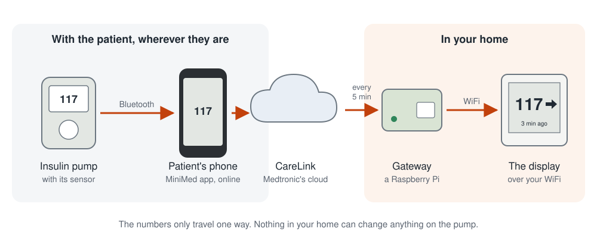
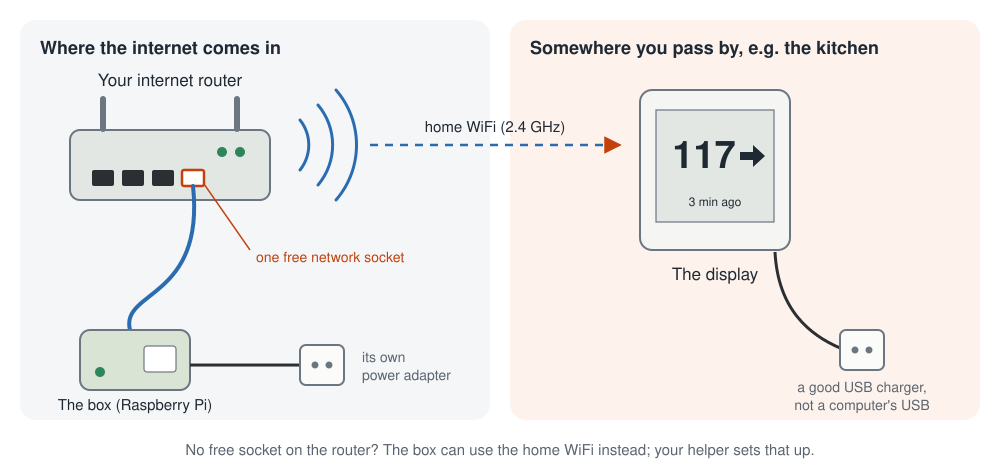
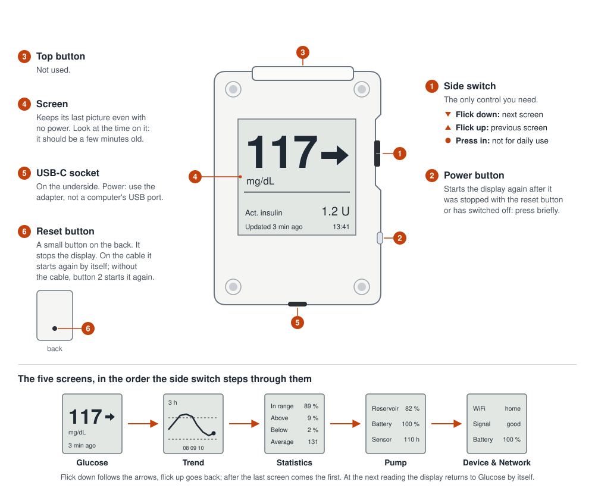

# CareLink home display — user guide

*[Nederlandstalige versie](handleiding.md)*

A small screen in your home that shows the glucose reading of someone who
wears a Medtronic MiniMed 770G or 780G insulin pump, so the people who care
for them can see it at a glance, without a phone.

This guide has three parts:

1. [What it is and what you need](#1-what-it-is-and-what-you-need), for
   everyone.
2. [Preparing the devices](#2-preparing-the-devices), for the person with a
   technical background who sets it up for you.
3. [The set in your home](#3-the-set-in-your-home): where everything goes,
   what the screens show, and what to do when something looks wrong.

## 1. What it is and what you need

### How it works

The pump already sends its readings to the patient's phone, and the phone
sends them to CareLink, Medtronic's online service. The set adds two things
in **your** home:

- **The box**, a small computer (a Raspberry Pi) next to your internet
  router. Every five minutes it fetches the latest reading from CareLink.
- **The display**, a small e-paper screen, about 3 by 3 cm. Every five minutes
  it wakes up, takes the reading from the box over your WiFi, shows it, and
  beeps when the pump has an alarm.

The patient does not need to be at home: the display works wherever they
are, as long as their phone is on, near the pump and online.

### What it is not

- **It cannot change anything.** It only shows numbers. Nothing in the set
  can give insulin, change pump settings or silence a pump alarm.
- **It is not a medical device and not an alarm system.** The pump and the
  phone remain the things that warn. The display puts the same numbers in
  another room.
- **It is always a few minutes behind.** The pump, the box and the display
  each work in steps of five minutes.
- **It depends on the patient's phone.** When the phone is off, too far from
  the pump or offline, the display says so; that is not a fault of the set.

### What you need

| You need | |
|---|---|
| **The two devices** | the box and the display, prepared by your helper (part 2) |
| **Internet at home** | a router with **one free network socket** for the box. No free socket: the box can use your WiFi instead |
| **Your WiFi name and password** | the display connects to your WiFi. It needs the 2.4 GHz kind, which almost every home router offers, often under the same name |
| **A separate CareLink account for the display** | see below |
| **Two power sockets** | one near the router for the box, one where the display goes |
| **A helper with a technical background** | to prepare the devices and install them with you, about 45 minutes in your home |

### A separate CareLink account, accepted by the patient

The box signs in to CareLink with an account of its own: a **care-partner
account**. It is an ordinary CareLink account, made for this display only,
that the **patient invites as a care partner** from their own CareLink
account, and that accepts the invitation. This is what allows the box to
read the patient's data.

Why a separate account:

- **The patient stays in control.** Removing the care partner in their own
  account switches the display off, without changing their own password.
- **It is safer.** The box holds only this account's sign-in, which can read
  one patient's data and nothing more.
- **It must not be used anywhere else.** A care-partner account can be
  signed in at one place only. Signing in with it on a phone, or in a second
  box, stops the display a few hours later.

Whoever owns that account keeps its **password and the device that receives
its two-factor code** (the extra code CareLink asks for at sign-in) at hand. They are needed
once at the installation, and then about twice a year when CareLink asks
for a new sign-in (see [part 3](#about-twice-a-year-sign-in-again)).

### Who does what

| Who | What |
|---|---|
| **The patient** | invites the care-partner account from their own CareLink account |
| **You, the household** | provide the WiFi name and password, a place for both devices, and the care-partner account's sign-in at the installation and about twice a year |
| **Your helper** | prepares both devices, installs them with you, and is the one you call when something is wrong |

## 2. Preparing the devices

*For the helper.* This part says what is involved and what skills it takes.
The step-by-step instructions are in the [staging and support
runbook](runbook.md), the [home installation
checklist](home-installation-checklist.md) and [what you need on your own
computer](staging-setup.md).

### The skills it takes

You do not need to be a programmer. You do need to be comfortable with:

- **Following instructions to the letter**, including typing commands into
  a terminal exactly as written and reading what they answer.
- **Preparing a Raspberry Pi**: writing a memory card with Raspberry Pi
  Imager, and logging in to the Pi from your laptop over SSH with a key
  instead of a password.
- **Home networks**: finding a free socket on a router, telling a 2.4 GHz
  WiFi from a 5 GHz one, and joining a phone or laptop to a given WiFi.
- **Passwords and accounts**: keeping a few passwords safe per household,
  and helping someone through a sign-in with a two-factor code without ever
  seeing their password.
- **Being the contact**: the household will call you when the display looks
  wrong. Most of that can be checked remotely, through Raspberry Pi Connect.

### Shopping list

| Item | Notes |
|---|---|
| M5Stack Core Ink | the display |
| Raspberry Pi 4 | the box; the model this is tested on |
| microSD card, 16 GB or more | for the Pi |
| Raspberry Pi power adapter | the official one: a weak adapter causes faults that look like software problems |
| Network cable | from the router to the Pi |
| USB-C charger for the display | a good one, not a computer's USB port |

### The display: flash it from the browser

The display's software goes on in about a minute, from a web page:
**[Flash the CareLink home display](https://fredvangoolen.github.io/carelink-home-display/)**.
Open it in Chrome or Edge on a laptop, connect the Core Ink with a USB-C
cable, press *Install*. Choose *Erase* for a new display or one that goes to
another household; choose *Do not erase* to update a display in use.

The display's WiFi and the address of the box are filled in later, in the
home: a wiped display shows a QR code that leads a phone to its setup page.

### The box: prepare it on your desk

Done on your own desk before the visit, about an hour the first time:

1. Write Raspberry Pi OS Lite to the memory card with Raspberry Pi Imager,
   with a name for the box (`carelink-<name>`) and your SSH key.
2. Log in to it from your laptop and run one script, which installs
   everything: `appliance/provision.sh`.
3. Choose the password for the sign-in screen (the VNC password), print the
   label for its setup hotspot, and link it to Raspberry Pi Connect for
   remote help.

The box does **not** sign in to CareLink on your desk. That happens in the
home, with the care-partner account, once the box is on the home network.

### The visit

About 45 minutes, following the [home installation
checklist](home-installation-checklist.md): connect the box, let the account
holder sign in to CareLink on a laptop, set up the display from a phone, find
it a good spot, and check that a current reading arrives.

## 3. The set in your home

- **The box** sits next to your internet router, with a network cable in a
  free socket of the router, and its own power adapter. It has no screen and
  needs nothing from you.
- **The display** goes somewhere people pass by, such as the kitchen or the
  hallway, on its own USB charger. It must be within good reach of your WiFi:
  the *Device & Network* screen says how good (*Signal*: *good* or *fair* is
  fine).

### The screens

The **side switch** is the only control you need: flick it down for the next
screen, up for the previous one.

| Screen | Shows |
|---|---|
| **Glucose** | the latest reading, the trend arrow, active insulin, and how long ago the reading was taken. Alarms from the pump show here, with a beep |
| **Trend** | the last 3 hours as a line, with dashed lines at 70 and 180, a dotted line at 100 (the pump's target), and the hours along the bottom. On the display, the zones below 70 and above 180 are dotted; the clear band between them is in range. The scale stretches to fit the readings; a number at the top right shows how high it goes when a peak passes 200. The dot is the latest reading; a line that stops short of the right edge means no readings came in since |
| **Statistics** | the last 24 hours: time in range, above, below, and the average |
| **Pump** | reservoir, pump battery, and sensor age |
| **Device & Network** | the WiFi it uses and how good the signal is, and the display's own battery. Your helper may ask you to read this one out |

At the next reading, within five minutes, the display returns to *Glucose* by
itself.

### What normal looks like

**The time on the screen is a few minutes old.** That is normal, always.

The screen is e-paper: it keeps its last picture, even without power. So a
display that has stopped looks exactly like one that works. **Look at the
time.** More than about 15 minutes old means something needs attention.

When there is no new reading, a line at the bottom of the *Glucose* screen
says why. It appears only after about 15 minutes, so a short gap never shows.

| The line says | Means | What to do |
|---|---|---|
| *No sensor data since 13:40* | the sensor, the pump or the patient's phone has not sent a reading since that time | nothing; it clears itself. If it lasts, check the patient's phone |
| *Pump suspended* (or another pump message) | the pump says why there is no reading, for example it is disconnected; this replaces *No sensor data* | nothing, unless it lasts longer than expected |
| *No new reading for …* | everything answers, but the reading has not changed | check the patient's phone and its MiniMed app |
| *Proxy has no data* | the box cannot reach CareLink | check that your internet works; the box tries again every minute |
| *CareLink login needed* | CareLink wants a new sign-in | call your helper (see below) |
| *No link to proxy* | the display cannot reach the box | check that the box has power and its cable; then restart both (below) |

("Proxy" is the box.)

### When it seems stuck

1. Unplug **both** the box and the display.
2. Wait 10 seconds and plug them back in.
3. Wait 5 minutes.

Still no current reading? Call your helper.

### About twice a year: sign in again

Now and then CareLink asks for a fresh sign-in, and only the owner of the
care-partner account can do it. The display then says *CareLink login
needed*. Your helper will call you and send you a link; you open it on a
laptop or phone at home and sign in to CareLink with the care-partner
account's password and its two-factor code. You type the password yourself;
your helper never asks for it.

Three things look like faults and are not:

- a red warning that the page is **"not secure" or "without HTTPS"**
- a **grey, empty screen** for a moment before the CareLink page appears
- the page **disappearing** as soon as the sign-in succeeds. That is the
  sign that it worked.

### Taking it on holiday

The set can travel along: the box and the display find each other in a
holiday home too, even on WiFi that would normally keep them apart. Ask your
helper before you go; the details are in [travel.md](travel.md).

### On your computer as well

The same *Glucose* screen can also run in a window on a computer in the
house: as a backup when the display is away, or on the patient's own desk.
Your helper installs it (instructions in
[desktop/README.md](../desktop/README.md)); it needs Python, which is free,
and the box's address. *Monitor → Test sound* lets you hear the alarm tone.
It shows the same messages as the table above, but only while the computer
is on and awake: a sleeping computer shows nothing.

For a quick look from any computer or phone at home there is also a page in
the browser: `http://` followed by the box's name and `:8081/display`, for
example `http://carelink-01:8081/display`. It is meant for a glance and for
your helper's troubleshooting, not for keeping open as a monitor: a browser
plays no sound until you click *Enable alarm sound*, and stops when the
computer sleeps or the tab is closed.

---

*This display repeats information from an insulin pump. It is not a medical
device and not an alarm system. Rely on the pump and the phone for warnings.*
