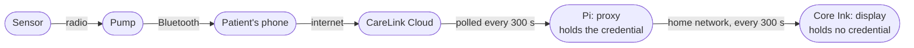

# CareLink Monitoring Set — Staging & Support Runbook

Staging, delivering and supporting a remote glucose monitoring set: one Raspberry Pi running the CareLink proxy, one M5Stack Core Ink display, installed in a patient's home.

Written October 2026; last checked against the code on 2026-11-11. On site, work from the [Home Installation Checklist](home-installation-checklist.md); this document gives the reasons. What you need on your own laptop to stage a set is in [staging-setup.md](staging-setup.md).

## What the set is

A monitoring set is two devices either side of a cloud round trip. The pump never talks to the display directly.



The Pi is the only thing in the house holding a CareLink credential. The Core Ink holds none: it reads from the Pi and nothing else.

Four consequences worth stating to anyone receiving a set:

- **It is read-only.** Nothing in the set can change pump settings, deliver insulin or acknowledge a pump alarm. It repeats information; it does not act.
- **It is not an alarm system and not a medical device.** The pump and the phone remain the things that warn people. This puts the same numbers in another room.
- **It runs about five minutes behind.** The pump uploads on its own schedule, the Pi polls every 300 s, and the display wakes every 300 s.
- **It depends on the patient's phone.** Phone off, out of Bluetooth range or offline means the display shows *No data*, which is correct behaviour rather than a fault.

## Staging the Raspberry Pi

Do all of this on your own bench, on your own network. A set should arrive at the house fully provisioned and tested, needing only the network and one sign-in.

### 1. Image the card

Raspberry Pi OS **Lite** (64-bit). No desktop — the appliance grows its own browser when it needs one, and a desktop image only adds attack surface and update churn.

In Raspberry Pi Imager's advanced options, set all of these before writing:

| Setting | Value | Why |
| --- | --- | --- |
| Hostname | `carelink-<name>` | The Core Ink finds the Pi by this name, not by IP |
| User | your admin account | Never `pi`; never a name a household member would guess |
| SSH | enabled, **public key only** | Password SSH on a box holding a medical credential is not acceptable |
| WiFi | leave blank | Configure on site, so no stale network is baked in |
| Locale / timezone | the patient's | The display reads local wall-clock time from this |

### 2. First boot and updates

```bash
ssh <admin>@carelink-<name>.local
sudo apt update && sudo apt full-upgrade -y
sudo reboot
```

Confirm password SSH really is off before going further:

```bash
sudo sshd -T | grep -E '^(passwordauthentication|permitrootlogin)'
```

Both must read `no`. If either does not, fix it now — not after the box is in someone's house.

### 3. Provision

```bash
git clone <this repository> && cd carelink-home-display
./appliance/provision.sh
```

This installs the proxy, the Python environment, geckodriver, the four display units and a narrow sudoers rule. It also sets up automatic security updates, the on-disk system log, a check that keeps the Pi's own network name, and the three radio features: the setup hotspot, the WiFi watchdog and the display's fallback hotspot `carelink-travel` (see [travel.md](travel.md)). It is idempotent: re-running it is how you upgrade a Pi later, and it will not disturb a token that is already installed.

For a Pi that will never leave one house and should not touch its radio (one that is also the house DNS server, say), run `STAY_HOME=1 ./appliance/provision.sh` instead: the same proxy and renewal path, none of the three radio features.

### 4. Set the VNC password

```bash
x11vnc -storepasswd ~/.vnc/passwd
```

**Unique per household.** Never reuse one across sets — it is a shared secret that a household member will be told over the phone, and one leak must not reach every other patient. VNC auth truncates to 8 characters, so anything longer is decoration.

Write it in your own records against the hostname. There is no way to recover it; the only fix is to set a new one over SSH.

### 5. Rehearse the sign-in, but take no token

```bash
/opt/carelink-renewal/renew.sh
```

The token is fetched **in the home**, once the Pi is on the household network: see the [Home Installation Checklist](home-installation-checklist.md), step 2. On the bench, prove only that the sign-in path works: run the command above, open the printed link, enter the VNC password, and check that the CareLink sign-in page loads. Then press Ctrl-C; the teardown runs. **Do not sign in.** Any account you would use is live somewhere else, and a sign-in here would end that session; the patient's care-partner account must sign in once only, at the home.

Give every set a **dedicated care-partner account**: a CareLink account made for this proxy alone, which the patient invites as a care partner from their own account. The patient's invitation is the authorisation, and it is theirs to withdraw: removing the care partner cuts the set off without touching their own password. Nothing else may sign in with that account. A care-partner account carries one live session, so the same login in a phone app would knock the proxy out, or the other way round. Link exactly one patient to it: the proxy shows the first patient it finds.

That limit is the care-partner account's. The patient's **own** CareLink account has been proven to work in the proxy while the patient keeps using it as normal on their phone. A dedicated care-partner account is still the rule, for security: the token on the Pi then gives access to this one patient's data as a care partner, not to the patient's own account, and the patient can withdraw it without changing their password.

Decide per set who holds that account's password and its two-factor device. Whoever performs a renewal needs both at that moment.

What the sign-in asks for varies, so tell whoever signs in to expect any of: a tick box, a picture CAPTCHA, a two-factor code. On 2026-10-23 a new care-partner account got only the *I'm not a robot* tick box but a two-factor code. The patient's own account, with two-factor also on, had earlier been given a picture CAPTCHA. Medtronic decides per sign-in.

Rehearsed on the home set on 2026-10-23 with a new care-partner account: 6 minutes from start to installed token. The proxy found the patient at once, and the renewal ports were closed again afterwards. As always, the first refresh, 3 hours later, is the proof.

**One account, one live set.** A fresh browser login with a care-partner account invalidates every other machine holding a session for that account. The trap is that it does not look that way: the old box keeps serving normally for hours, because it is still running on an access token that has not expired. Only when it next needs to refresh does it fail, with `ERROR: failed to refresh token`, and both displays go blank at once.

So never renew on a spare while a live set is running on the same account. If you are replacing a set, move the token to the new box rather than logging in again, and treat the first successful *refresh* — not the first successful fetch — as proof that it worked.

### 6. Enable the proxy (on site, after the sign-in)

```bash
sudo systemctl enable --now carelink2-proxy.service
curl -s localhost:8081/carelink/nohistory | head -c 200
```

You should see the patient's own first name in the response. That proves the care-partner account is linked to the right person. If you see somebody else's, the account is linked to the wrong patient, or to more than one.

### 7. Remote access

```bash
sudo apt install -y rpi-connect-lite
rpi-connect signin          # your Raspberry Pi ID, two-factor on
rpi-connect shell on
loginctl enable-linger      # keeps Connect running with nobody logged in
rpi-connect status
```

Check from connect.raspberrypi.com that the Pi is online and a remote shell opens, then reboot and check again. Connect opens no port: `ss -tlnp` must look exactly as before. Screen sharing is not needed and not available on Lite.

### 8. Label the setup hotspot

`provision.sh` gives every Pi a fallback setup hotspot, `carelink-<name>-setup`, with a password of its own. It appears only when the Pi boots with no network at all, for 5 minutes, so a phone can give it a WiFi network (see *Three ways a set connects*). Make its label on your laptop, print it, stick it on the Pi, and delete the image, since it holds the password:

```bash
appliance/make-label.sh admin@carelink-<name>.local
```

## Staging the Core Ink

The display holds no credential and can do nothing but read. That makes it the easy half — but it is also the half the household actually looks at, so bench-test it until it is boring.

### 1. Flash

```bash
FQBN=esp32:esp32:m5stack_coreink:PartitionScheme=huge_app
arduino-cli compile --fqbn "$FQBN" --upload -p <port> firmware/minimed-coreink
```

`huge_app` is not optional. The default scheme reserves two OTA slots this project never uses and leaves too little room for the WiFi and JSON build.

Without a build environment, flash a released build from a browser instead: see [staging-setup.md](staging-setup.md).

### 2. Configure

The device stores its settings in NVS. Three ways in:

- **The setup portal**, for a device with no settings. It raises an access point `M5INK_MINIMED_MON` with a fresh random password, shown on the panel as a WiFi QR code and as text. A phone that scans it is led to the form by itself (a captive portal); otherwise browse to `http://192.168.4.1`. The form lists the 2.4 GHz networks in range to pick from, and takes two WiFi networks, a fallback network (leave it empty, see below), the proxy name and port, the timezone (pre-filled 1, Brussels; summer time is automatic) and an optional patient name. **Test and save** joins each network and looks the proxy up before anything is stored, and warns about a name that is nearly, but not exactly, one it can see ("Did you mean …?"). A mistyped WiFi name was the costliest setup error so far.
- **The on-device wipe**, to start over on a configured device: on *Device & Network*, hold the toggle pressed in for 5 seconds, flick to *Yes* and press. It clears the settings and the last reading and restarts into the portal. Use it before a display changes household.
- **A one-shot sketch**, for development and support only (to change a display's WiFi, normally set it up again on the device: it takes a phone and a few minutes), to change a WiFi slot without re-entering everything else: `firmware/tools/nvs-slot-edit/` dumps, sets, renames and clears slots over USB, with passwords never printed. Flash it, make the change, then flash the real firmware back. An app upload does not touch NVS.

Set these:

| Key | Value |
| --- | --- |
| `wifissid` / `wifipass` | the household WiFi — slot 0 is tried first on a cold boot |
| `ssid1` / `pass1` | a second household-type network, only if the set really lives in two places |
| `ssid2` / `pass2` | the fallback: the Pi's `carelink-travel` hotspot. **Leave empty.** The display fetches it from the proxy at its first good reading and keeps it up to date |
| `proxyaddr` | `carelink-<name>.local` — the **name**, never an IP |
| `proxyport` | `8081` |
| `patient` | optional; the proxy reports the first name anyway |
| `timezone` | the patient's offset |

Use the hostname rather than an address. Home routers reassign DHCP leases, and a set that dies three weeks after delivery because the Pi moved from `.31` to `.44` is the single most avoidable support call in this whole design. The display looks the name up once (IPv4 only), remembers the address, and looks it up again only when that address stops answering.

### 3. Put the right network in slot 0

Slot 0 is tried first before the cached-AP hint exists, so it should be the network that is always present. Getting this backwards costs roughly **12 seconds of radio time on every cold boot** — an 8 s timeout on an absent network, then a scan — against about 1.2 s when slot 0 is right.

It only bites on cold boots, never on ordinary wakes, so it is a battery and first-impression matter rather than a fault.

### 4. Watch a full cycle on the bench

There is no emulator. Attach a serial console and watch at least one complete wake:

```
coreink: power hold at 1858 us, reset 1, wake 0, cold 1, cycle 0
wifi: slot 0 (HomeNet)
wifi: connected in 1178 ms, ip 192.168.1.30
clock corrected from proxy by +5 s
fetch+parse: 107 ms, ok=1
sleeping 300 s (awake 4310 ms)
```

Five numbers tell you the set is healthy: WiFi association near **1.2 s**, a signal (`rssi` on the same line) of **−75 dBm or better**, a proxy lookup of a few milliseconds on a cold boot (after that the address is remembered and no lookup is logged), fetch near **100 ms**, and awake time near **4.3 s**. A cold boot above about 15 s means slot 0 is wrong. A *clock corrected* line should appear on the first cycle only: the board then keeps its clock chip in step.

Then leave it running unattended for a day. Some faults — a reconnect that is fine most cycles and occasionally slow after a cold radio init — only appear across many wakes.

## Before it leaves the bench

Every one of these must pass. Each exists because of a failure that is expensive once the hardware is in someone else's house.

- [ ] **Password SSH is off.** `sudo sshd -T | grep passwordauthentication` reads `no`.
- [ ] **Nothing is listening but SSH.** `ss -tlnp` shows port 22 and, once the proxy is enabled, 8081. With the `carelink-travel` hotspot up there is also port 53 on `10.43.0.1` only: the hotspot's own name service, which its firewall drops anyway. Ports 5900 and 6080 must be absent while idle.
- [ ] **The display chain is not enabled at boot.** `systemctl is-enabled xvfb openbox-session x11vnc novnc` reads `disabled` four times. This is the whole security argument; enabling it discards the design.
- [ ] **The sign-in path works.** `renew.sh` run on this box up to the CareLink sign-in page, then stopped with Ctrl-C. No sign-in.
- [ ] **The renewal tears down cleanly.** After `renew.sh` finishes or times out: no listeners, no `firefox-esr` or `geckodriver` processes, no `/tmp/carelink-renew.*` directories, and `systemctl --failed` is empty.
- [ ] **No token on the card.** `/var/lib/carelink/` is empty, and `carelink2-proxy` is disabled.
- [ ] **No credential is in any log.** `sudo journalctl | grep -c refresh_token` returns 0. If it does not, the Pi was provisioned before the logging fix — rotate the token and vacuum the journal.
- [ ] **The display has run for a day** against your own proxy, and has then been wiped on the device.
- [ ] **The Pi survives a power cut.** Pull its mains and restore it: it comes back online in Connect, with nothing on 5900 or 6080. The full test, both devices and a current reading, follows in the home once the proxy is active. That one is what actually happens in a house, and it exercises cold-boot WiFi, mDNS and token reload in one go.
- [ ] **The VNC password is recorded** against the hostname in your own notes.
- [ ] **The patient's care-partner account is ready:** it exists, it is linked to the patient, and it has never been signed in anywhere. The first name in the proxy response confirms the link on site.
- [ ] **Remote access works and survives a reboot.** The Pi shows online at connect.raspberrypi.com, a remote shell opens, and `ss -tlnp` shows no new listener.
- [ ] **Security updates install themselves.** `systemctl is-active unattended-upgrades` reads `active`, and `sudo unattended-upgrade --dry-run --debug | grep 'Allowed origins'` lists Debian-Security and Raspberry Pi Foundation. `provision.sh` sets this up, including a reboot at 14:00 when an update needs one. Install everything pending before the set leaves, so it does not start life rebooting.
- [ ] **The setup-hotspot label is on the Pi**, and the label image is deleted from your laptop. `systemctl is-enabled carelink-setup-ap` reads `enabled`.
- [ ] **The radio helpers are on.** `systemctl is-enabled carelink-wifi-watchdog.timer carelink-travel-ap.timer` reads `enabled` twice (not on a `STAY_HOME=1` Pi, which has neither).
- [ ] **The name check is on.** `systemctl is-enabled carelink-mdns-name.timer` reads `enabled` (on every Pi, `STAY_HOME=1` included).
- [ ] **The display runs the normal build**, not a test build: see [testing.md](testing.md).

A set that fails the power-cut test is not ready, however well everything else reads.

## Installing in the home

Two things happen on site: the network, and activating the proxy with the patient's care-partner account. Everything else was settled on the bench, and if you find yourself changing anything else, stop and take the set home. The step-by-step version is the [Home Installation Checklist](home-installation-checklist.md); this section gives the reasons.

### Three ways a set connects

| Use case | When | How the Pi gets on the network |
| --- | --- | --- |
| **Wired LAN** (the default) | a free port on the router | Ethernet; nothing to configure |
| **Home WiFi** | no free port, or the router is out of reach | first boot without a network raises the setup hotspot for 5 minutes; scan the label, pick the household WiFi. The Pi keeps it |
| **Away from home** | a holiday house or any WiFi the display does not know, or one that stops devices talking to each other | the Pi joins that WiFi through its setup hotspot, as above, and the display reaches it over the Pi's own hotspot, `carelink-travel` |

The last row needs nothing from you on the day. The Pi runs `carelink-travel` all the time, next to its own connection; the display learned its password from the proxy at home, and switches to it by itself when the household network does not get it to the proxy, trying the household network again every hour. [travel.md](travel.md) has the whole picture and its limits, the main one being that the Pi moves itself to 2.4 GHz to do this.

Whether a WiFi blocks devices from talking to each other shows on the display: *No link to proxy* at the bottom of the main screen, with a good Signal row on *Device & Network*, is the sign. Before believing it, check the WiFi name on the display character by character: the one time this was seen, at a holiday house, it was a mistyped name and not the router ([lessons.md](lessons.md)).

### Network

Put the Pi on **Ethernet** if there is any socket within reach. It removes a whole class of support calls, and the Pi is usually near the router anyway.

If it must be wireless, or for the Core Ink either way:

1. Set the household WiFi into slot 0 (Core Ink) and into the Pi.
2. Reboot both and watch one full cycle.
3. Check `.local` resolution actually works on this network: `ping carelink-<name>.local` from a phone. Some routers and some mesh systems block mDNS between wireless clients, or between the 2.4 GHz and 5 GHz bands.

If mDNS does not work on their network, the name cannot work there either. Give the Pi a **DHCP reservation** on the router first, then enter that reserved address on the display instead of the name. Without the reservation, a typed address lasts only until the router hands the Pi a different one.

The Core Ink is 2.4 GHz only. On a router that presents one name for both bands this is usually fine, but it is the first thing to suspect if the Pi connects and the display does not.

### Power and placement

**Power the Pi from a proper adapter.** A marginal supply passes every test except the one that matters — the WiFi radio's power-up inrush — and the failure looks exactly like a software hang.

For the display: somewhere it is seen in passing, such as a kitchen or a hallway, not a bedside. It is e-paper, so it needs no darkness and emits no light. It holds its last image with no power at all, which is worth saying out loud, because **a frozen display and a working one look identical.** The time on the screen is what tells them apart.

### Before you leave

- Pull the power on both, restore it, and wait for a current reading. Do it in front of them.
- Show them where the plugs are and which is which.
- Leave the VNC password written down somewhere they can find it in six months.
- Take a note of the router make and model. You will want it when mDNS misbehaves.

## Handing it over

The household needs to know four things. Resist telling them more — everything else is your job, and a long briefing makes people afraid to touch it.

**1. What it shows.** A glucose reading, a trend arrow and the time it was taken. Flick the side switch to page through the glucose statistics, pump battery, reservoir and sensor life, and the network screen, which is for when you ask them to read something out.

**2. What normal looks like.** The number is a few minutes old, always. When there is no reading, a line at the bottom says why, and only after about 15 minutes, so a short gap never shows: *No sensor data* (sensor or pump not reaching the phone; it clears itself), *Proxy has no data*, *CareLink login needed* (call you), *No link to proxy* (the display cannot reach the Pi), and *No new reading for …* (everything answers, but the reading has not changed for 20 minutes or more). *No sensor data* also says since when: the time of the last reading, or how many days past a day.

**3. How to tell it is stuck.** The e-paper keeps its last picture with no power, so a dead display looks exactly like a live one. **Check the time on the screen.** More than about fifteen minutes old means something needs attention. The remedy is the same as for anything else: unplug both boxes, wait ten seconds, plug them back in, wait five minutes.

**4. The one thing only they can do.** Perhaps twice a year, CareLink will insist on a fresh sign-in: a tick box or picture CAPTCHA, and a two-factor code. Nobody else can complete it — not remotely, not by you. When that happens you will ring them and walk them through it.

For that call they need: the noVNC link, the VNC password, the care-partner account's username and password, and its two-factor code. Tell them in advance that you will never ask for the CareLink password yourself. They type it, you do not see it, and that promise is what makes a real phishing attempt obvious later.

Warn them about the three things that look like faults and are not: a red *"without HTTPS"* warning on the renewal page, a grey empty screen before the browser appears, and the browser window vanishing the instant the login succeeds. All three are expected. The last one is the success signal.

Give them one route to reach you, and make it the same route every time.

## Monitoring and troubleshooting remotely

### Getting in

You need a way to reach the Pi from outside the house. Ranked:

1. **Raspberry Pi Connect** (`rpi-connect-lite`), remote shell only. The Pi connects outbound to Raspberry Pi's relay, so nothing listens, nothing is forwarded and the household router is untouched. Sign in with a Raspberry Pi ID that has two-factor on: that one ID now opens a shell on every set. A mesh VPN would also work, but it adds a second network to every Pi for nothing Connect does not already give.
2. **Nothing, and you visit.** Honest, and fine for one or two sets.
3. **Port-forwarding SSH.** Avoid. It puts a box holding a medical credential in front of the whole internet's scanners.

Whatever you choose, never put remote access in front of ports **8081** or **6080**. The proxy has no authentication at all, and the renewal screen is a live view of somebody typing their password. Both are LAN-only by design; Connect's remote shell reaches the Pi, and the shell reaches them over loopback if you need to.

### First five commands

```bash
systemctl is-active carelink2-proxy.service
curl -s localhost:8081/carelink/nohistory | head -c 300
sudo journalctl -u carelink2-proxy.service --since -1h | tail -20
ss -tlnp | grep -E ':6080|:5900'
sudo ls -l /var/lib/carelink/
```

In order: is it running, is it getting data, what has it been saying, is anything exposed that should not be, and when was the token last written. A token mtime that keeps advancing is the healthiest single signal in the system — it means the refresh chain is alive.

### Reading a fault from a distance

Two things say which link in the chain pump → phone → CareLink → proxy → display broke, usually before you open a shell: the line at the bottom of the display's main screen, which the household can read out to you, and the proxy's page at `http://<pi>.local:8081/`, which says since when there is no data and why.

| Bottom of the main screen | Where it broke | Proxy page |
| --- | --- | --- |
| *No sensor data since …* | sensor, pump, or the patient's phone not uploading; clears itself | *Login successful*, last data recent |
| *No new reading for …* | everything answers, but the reading has not changed for 20 minutes: the patient's phone app, or a proxy stuck on one fetch | if the phone is fine: restart the proxy |
| *Proxy has no data* | the Pi cannot reach CareLink: its own internet connection, or a CareLink outage | *Logged in, but no data from CareLink*, with the reason; it retries every minute |
| *CareLink login needed* | the token: CareLink refused it | *Valid token required*; *refused the token refresh* means a renewal is needed |
| *No link to proxy* | the display is on the WiFi but cannot reach the Pi: the Pi is down, or the network keeps devices apart | the page does not open either, or it does and the network is the problem: check the Signal row on *Device & Network* |
| *No WiFi - see Network* | the display joins no WiFi at all (plan A nor plan B) | unaffected; check the WiFi name and *Signal* on *Device & Network* |
| *Update failed - see Network* | the display's polls do not finish: its watchdog cut them off, or brownouts; nearly always a weak signal | unaffected; ask for the *Debug* screen (below) |

**The debug screen.** A short press of the switch on *Device & Network* shows *DEBUG SINCE RESET*; another short press or a flick leaves it. It counts since the display was last switched on or reset with the back button, in RAM only (nothing written to flash), and the resets it counts do not clear it:

| Row | Counts |
| --- | --- |
| *Polls* | polls started / those that brought data from the proxy |
| *Watchdog* | polls cut off after 3 minutes, and the time of the last |
| *Brownout* | resets from a supply dip: battery or adapter too weak for the WiFi radio |
| *Crashes* | other crash resets; should stay 0 |
| *No WiFi* | wakes that joined no network |
| *No proxy* | joined, but the proxy did not answer |
| *Plan B* | polls over the Pi's travel hotspot |
| *Awake* | average / longest poll that finished, seconds: the battery cost, and how near the watchdog |
| *Batt mV* | battery voltage now; on USB, the charging voltage |

Watchdog or Brownout above 0 tells apart what the panel cannot: a hang or a power dip.

A message appears only after about 15 minutes, so a short gap never shows. [display-messages.md](display-messages.md) has every message, which one wins, and when each clears. On the bench, the serial log's `comms` line has the same chain in raw form (pump-phone, phone-cloud, the proxy's answer, the failure streak and the proxy address).

### Symptoms

| What you see | Usually means | What to do |
| --- | --- | --- |
| Display time is old, proxy is fine | Core Ink cannot reach the Pi | Check the Signal row on the display, mDNS from the LAN, and whether the household WiFi changed |
| Display frozen on the version splash | Power supply cannot carry the WiFi inrush | Replace the adapter. It is not software |
| Display shows *---* and *No sensor data since …*, proxy returns `sg: 0` | Pump is not reaching the cloud | Nothing to fix. Phone, range, or Medtronic |
| Proxy page says *Valid token required* | CareLink refused the token. The line under it says since when and why; *refused the token refresh* means the session is over, most often because the same account was signed in somewhere else | Schedule a renewal call with the household. The proxy retries the stored token by itself after 1 minute, then doubling up to every 30, so a token that was only refused once comes back without help |
| Proxy page says *Logged in, but no data from CareLink* | The Pi cannot reach CareLink: no internet, DNS, or a CareLink outage. Common right after a power cut, when the router is slower than the Pi | Nothing to renew. The proxy retries every minute and the data is back within a minute of the network. Check the Pi's own connection (`ping -c3 clcloud.minimed.eu`) |
| Proxy active, 401/403 in the journal | Token rejected upstream | Same — renewal |
| Cold boot takes 15 s of radio | Slot 0 holds an absent network | Reorder slots next time a board is in your hand |
| Display cannot find the proxy, but the Pi is up | avahi renamed the Pi `carelink-01-2.local` after a network hiccup | The name check puts it back within 2 minutes; `journalctl -u carelink-mdns-name` shows when. If it repeats every 2 minutes, another machine on the network has the same name |
| Pi on WiFi dropped off the network and came back by itself | A router hiccup; the WiFi watchdog reconnected it | `journalctl -u carelink-wifi-watchdog` lists every reconnect; "switching the radio off and on" means the chip had to be reset. Drops at the same times every day are often the router changing channel: fix its 2.4 GHz channel. Many reconnects means a flaky router: move the Pi to a cable |
| Display works, but *Device & Network* shows it on `carelink-travel` at home | The household WiFi is not getting it to the proxy; it fell back to the Pi's hotspot | It tries the household WiFi again every hour. If it stays, check the household WiFi name and password on the display, and mDNS on that network |
| Everything fine, no data since a date | Check the patient changed phone or password | Ask before debugging |

### Do not, remotely

- **Do not start the display chain and leave it.** That is the one action that puts a listener on their LAN. If you start it, watch it, and stop it.
- **Do not run `renew.sh` unattended.** It opens the listener for its full deadline whether or not anyone is there.
- **Do not change `proxyaddr` on a Core Ink you cannot physically reach.** Getting it wrong leaves a display that can never find its way back.
- **Do not reboot the Pi at night without reason.** Overnight is when the monitor matters most.

### What to check monthly

Token mtime advancing, `systemctl --failed` empty, disk not full, and the unattended upgrades actually ran (`/var/log/unattended-upgrades/`). The journal is kept across reboots, so `journalctl --list-boots` shows every restart; an unexpected one is worth reading with `journalctl -b -1`. Four commands, five minutes, and it catches almost everything before the household notices.

## Security attention points

The design rests on one boundary: **the household LAN is trusted, everything outside it is not.** Every rule below either defends that boundary or limits what happens when it fails. Worth being honest that the assumption is doing a lot of work — see the next section.

### What is exposed, and when

| Port | What | Reachable | When |
| --- | --- | --- | --- |
| 22 | SSH | LAN only; remote access is Connect's outbound shell, not a port | always |
| 8081 | proxy data, status page, live display page (`/display`) | whole LAN, **no authentication** | always |
| 5900 | x11vnc | loopback only (`-localhost`) | during a renewal |
| 6080 | noVNC | whole LAN | during a renewal |

The renewal chain is not enabled at boot, so 5900 and 6080 exist only while someone is logging in. That on-demand property is the entire argument for accepting a weak VNC password, and it is worth re-checking on every visit.

The fallback setup hotspot is the one other thing that can listen: the setup page on port 80, reachable only from the hotspot, and only when the Pi booted without any network, for 5 minutes. While it is up, the Pi drops everything else from the hotspot (SSH, 8081, 6080, 5900) and forwards nothing. Its password is per Pi and lives on the label, so treat the label like a key: anyone who reads it can join for those 5 minutes, and change which WiFi the Pi uses.

The display's fallback hotspot, `carelink-travel`, is up all the time once the Pi has a network. Its clients get an address, mDNS and the proxy on 8081, and nothing else: no SSH, no internet, nothing forwarded. Its password is random, 24 characters, per Pi, and the proxy hands it to anyone on the household LAN who asks (`GET /carelink/fallback`), which is how the display learns it. That adds nothing to what the LAN can already do: the hotspot leads only to port 8081, and the LAN reaches 8081 directly.

### Rules

- **Never enable the display units at boot.** One `systemctl enable` undoes the design.
- **Never forward 6080, 5900 or 8081** on a household router, and never put remote access in front of them.
- **One VNC password per household.** It is spoken aloud over the phone; treat it as compromised eventually and make sure one leak reaches one home.
- **A dedicated care-partner account per set**, invited by the patient and used by nothing else. The patient's invitation is the authorisation, and theirs to withdraw.
- **Key-only SSH**, and your key, not a shared one.
- **The renewal password is typed by the household, never by you.** Say so up front, so that anyone later asking them for it is obviously wrong.

### Data that lives on the Pi

The CareLink refresh token is the crown jewel: it grants ongoing access to this person's glucose history until revoked. It sits `root:root 0600` — but on an **unencrypted SD card**, so anyone who walks off with the Pi has it.

That is a deliberate trade. Full-disk encryption on a headless appliance means it cannot reboot unattended, which breaks the one thing it must do. Accept it, and respond to a lost Pi by revoking the CareLink session rather than by trusting the file mode.

The proxy also serves live patient data to anyone on the LAN who asks. In a family home that is roughly the intended audience. In a shared flat, a house with a guest network bridged to the main one, or a home with compromised IoT, it is not.

**Open, parked: DNS rebinding.** Removing the CORS header stopped other web pages from reading the data, except by one route. A malicious site opened in any browser in the house can point its own name at the Pi's address; the browser then treats the Pi as part of that site, and the page reads `/carelink` and sends it out. No LAN access is needed beyond the victim's browser. The giveaway is the `Host` header (`Host: evil.example:8081`), which the proxy does not check today. The live page (`/display`) does not change this exposure either way. The fix and its rollout are in the loophole table below (row "Proxy does not check the `Host` header"). Parked on 2026-11-16 until after the desktop monitor and the live page are in use.

### When a set is decommissioned

Have the patient remove the care partner from their account, and delete the care-partner account or change its password; either invalidates the tokens. Then wipe the SD card. Do not redeploy a card to another patient: shred it and image a fresh one. The cost of a card is not worth the chance of carrying one patient's token into another patient's house.

## Loopholes in this setup

Found by reading the code and the provisioning rather than by assuming the design is what the design intends. Two of these are in our own tooling. None is a reason not to deploy; all are reasons to know what you are deploying.

| Loophole | Severity | Why it matters | What would fix it |
| --- | --- | --- | --- |
| Proxy accepts a token by unauthenticated POST | High | `GUIURL = ""`, so `POST /` on 8081 is accepted **at any time**, not only when a token is needed, with no authentication. Anyone on the LAN can overwrite the credential — stopping the monitor, or pointing it at their own CareLink account so the display shows the wrong person's glucose | Fixed 2026-10-15: POST accepted only while a token is needed, cross-site `Origin` rejected, body capped at 16 KB. A per-device secret is still open |
| `Access-Control-Allow-Origin: *` on every response | High | Any web page open on a device in the house can read the full patient record cross-origin. No compromise needed — just a bad page in a browser on the same LAN | Fixed 2026-10-15: header removed |
| The handler has no access control at all | High | `do_GET` opens with a literal `# Security checks (if any) / # TODO`. Data, status and token replacement are all open to the LAN | Partly fixed by the two rows above; reading data stays open to the LAN by design. Binding to a known interface is still open |
| Proxy does not check the `Host` header (DNS rebinding) | Medium | A malicious web page in any browser in the house can resolve its own name to the Pi and read the full patient record through that browser. The proxy answers whatever name the request carries | **Parked 2026-11-16.** Answer only when `Host` (port ignored) is an IP address (a rebinding attack always uses a name), the Pi's own name (`carelink-01`, `carelink-01.local`), `localhost`, or a name listed in `/etc/carelink/` by `provision.sh` (an `EXTRA_HOSTNAMES=` switch); 403 otherwise. **Risk: breaking a working display.** The firmware sends the address it was configured with as `Host` (`minimed-coreink.ino:327`), so a display set up with a DNS alias the Pi does not know (a Pi that is also the house DNS server may be known by a name of its own) would show *No link to proxy* after the upgrade. Roll out in three steps: log each new `Host` without refusing anything, for a week or so on the reference Pi and the delivered sets; add the names the logs show to `EXTRA_HOSTNAMES`; only then refuse. A display configured by IP address never breaks. No change for households |
| Renewal screen is unencrypted on the LAN | Medium | VNC auth is 8-byte DES. Anyone on-path can capture the challenge and crack it offline, then join the shared session and drive the browser mid-login | TLS on websockify, or restrict 6080 by source address |
| noVNC exposes a desktop, not a kiosk | Medium | Openbox plus an unrestricted Firefox: whoever reaches it during a renewal can browse anywhere **from inside the home network** | Kiosk-mode Firefox, and a window manager with no menu |
| No firewall by default | Medium | 8081 and 6080 are open to every device on the LAN, including IoT and any guest network bridged to it | `ufw` allowing 8081 only from the display's address |
| Token at rest on an unencrypted card | Medium | A stolen Pi yields ongoing access to the patient's glucose history. File mode does not help against physical access | Accepted trade — encryption breaks unattended reboot. Respond by revoking, not by trusting `0600` |
| geckodriver installed with no checksum | Medium | Our own `provision.sh` downloads a binary and installs it as root with no signature or hash check | Pin a SHA-256 and verify before `install` |
| `selenium-wire` unmaintained since 2023 | Medium | Already needs three version pins to run on Python 3.13, and it is structurally required — the OAuth redirect is a custom app scheme that must be intercepted below the browser | Move the interception to Selenium BiDi network events |
| Sudo rule can raise the listener silently | Low | `systemctl start novnc` is NOPASSWD, so anything running as the admin user can open the LAN listener without a prompt | Inherent to on-demand triggering; audit instead |
| Core Ink config readable over USB | Low | `esptool read_flash` yields the household WiFi password in plaintext from NVS | Wipe it on the device before it leaves the house: hold the toggle in for 5 s on Device & Network, choose Yes |
| Fixed AP password `123456789` | Low | If NVS is ever wiped, the display raises an access point anyone nearby can configure, including pointing it at a hostile proxy | Fixed 2026-10-20: a random password per setup, shown on the panel as a QR code |

### The one that is not on the list

The structural weakness is the assumption itself: **the whole design trusts the household LAN.** That is reasonable in a family home and much less so in a shared flat, a home with a bridged guest network, or any house with the usual population of cheap IoT devices.

Everything in the table is a consequence of that assumption rather than a defect in spite of it. If one set ever goes somewhere the LAN cannot be trusted, rows one and two are already fixed, and the firewall in row six is the remaining minimum. It is small.

## Q&A: the pitfalls that actually happen

**The display is showing a reading but it looks wrong. Is it frozen?** Read the time on the screen, not the number. E-paper holds its last image with no power at all, so a dead display is indistinguishable from a live one. Anything older than about fifteen minutes needs attention.

**The display says *No data* but the Pi is fine. What broke?** Probably nothing of ours. `sg: 0` with `NO_DATA_FROM_PUMP` means the pump is not reaching the phone, or the phone is not reaching Medtronic. Check the proxy is returning a recent timestamp; if it is, the gap is upstream and it clears itself.

**It worked for three weeks, then stopped. Nothing changed.** The router reassigned the Pi's address, or mDNS stopped working on that network. This is the most common failure in the whole design. The display looks the name up again by itself when the remembered address stops answering, so a Pi that moved is found within a cycle, as long as mDNS works. Fix it with a DHCP reservation on the router and keep using the hostname — do not hard-code an IP into the display.

**The display sits on the version splash and never updates.** Power supply, not software. The WiFi radio's power-up inrush collapses a marginal rail, and because the board never reaches deep sleep, every retry is another cold boot. A PC USB port passes every test except this one. Replace the adapter before reading any code.

**Can I do the CAPTCHA renewal for them remotely?** No, and that is deliberate. Someone has to be on the household LAN to reach the renewal screen. You can start the chain over SSH and talk them through it, but the login happens in their house, on their network, with their credentials.

**They are worried about the red "not secure" warning on the renewal page.** It does not apply here. noVNC prints it whenever the page is not a secure context, without checking whether anything in use needs one. What needs it is the RSA-AES security type; `x11vnc -rfbauth` offers only VncAuth, whose DES is pure JavaScript. Explain it rather than hiding it — and do not switch to a self-signed certificate, which replaces a small banner with a full-page browser warning aimed at the least technical person in the chain.

**Should I just leave the renewal services enabled so it is ready?** No. That single change discards the design: it puts a permanent, weakly authenticated view of a desktop on the household LAN, in exchange for saving one command you run perhaps twice a year.

**I lost the VNC password.** Set a new one over SSH. There is no recovery, and a `passwd` file whose plaintext nobody holds is worse than no file — it looks configured and cannot be used.

**The renewal ran but the proxy is still asking for a token.** Check the working directory was clean. If a valid `logindata.json` is already present the login script prints *token data file already exists* and does nothing — no renewal, no error. `renew.sh` uses a fresh temporary directory precisely so this cannot happen; if you ran the login script by hand, this is why.

**Can I clone a staged card to set up the next patient faster?** No. The card carries a CareLink token, a hostname and a VNC password, all of which are per-household. Cloning one puts one patient's credential in another patient's house. Image fresh and run the provisioner — it exists to make that cheap.

**I set up a second Pi and now the first one has stopped.** Expected, and it will have looked fine for hours in between. One CareLink account carries one live session: the new login killed the old refresh token, but the old Pi kept serving until its access token ran out and its first refresh failed. You cannot run two sets from one care-partner account. Move the token to whichever box is staying, restart its proxy, and watch for a successful refresh in the journal.

**Everything looks healthy but there has been no new data since a specific date.** Ask before debugging. A changed CareLink password, a new phone, or a replaced sensor explains most of these, and no amount of log reading on the Pi will reveal it.

**A set is coming back. What do I have to do?** Have the patient remove the care partner, then delete the care-partner account or change its password, which invalidates the tokens. Then destroy the SD card. Wipe the Core Ink before it leaves the house: hold the toggle in for 5 s on *Device & Network* and choose *Yes*. Otherwise its NVS still holds the household WiFi password in plaintext, readable over USB.
